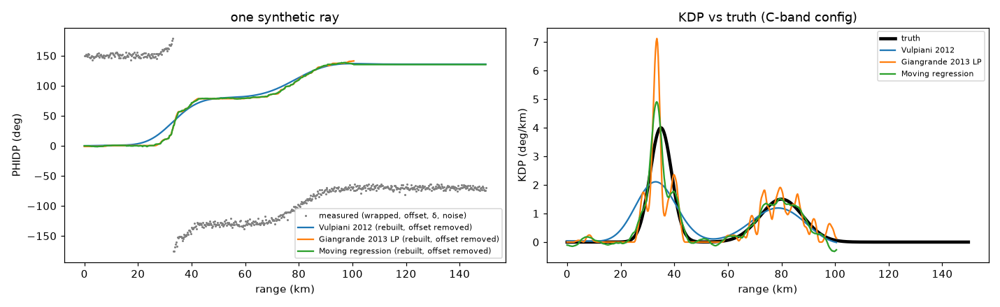
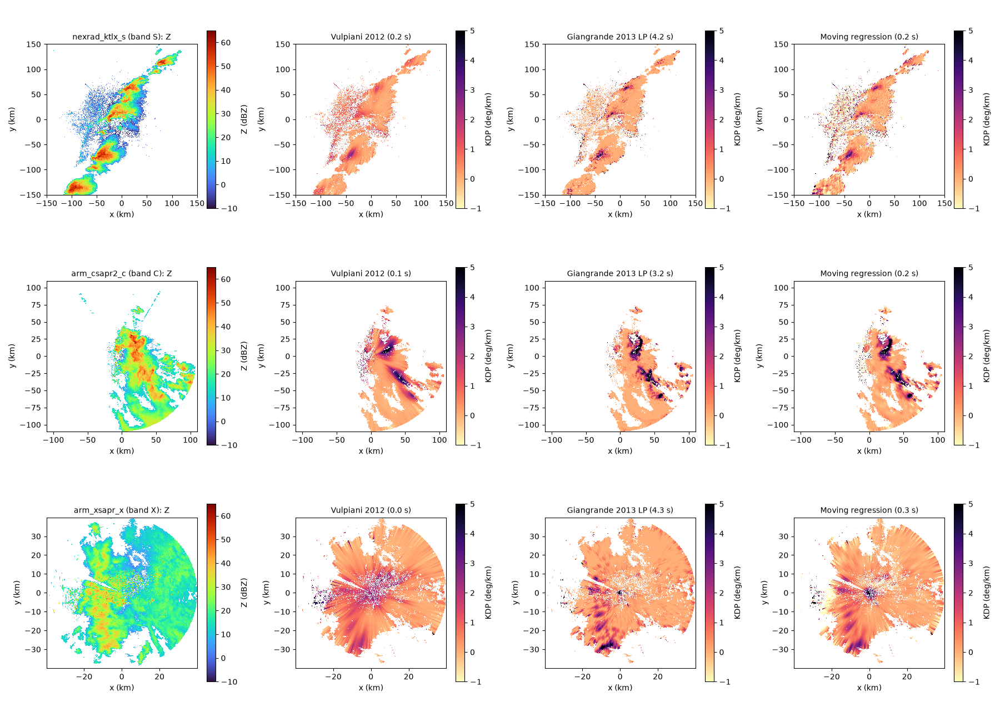
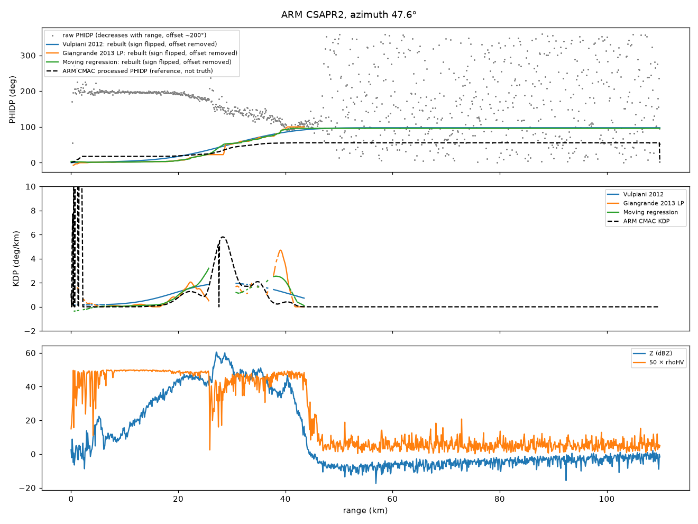
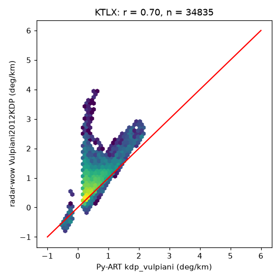

# radarwow-kdp

**radar-wow stage 3: PHIDP processing and KDP.** Unfolding, sign convention, system offset, KDP estimation.

Part of [radar-wow](https://github.com/radar-wow), a set of repos that together build a radar QPE system that works for S, C and X band radars.
Every algorithm is one class implementing one paper, with the same interface: it takes an xradar sweep or volume with canonical moment names, declares the bands and moments it needs, and records provenance.

## Sub-components

| sub-component | algorithm | source | DOI | status |
|---|---|---|---|---|
| PHIDP preparation | `radarwow.kdp.phase.prepare` | unfold, sign, offset, rain mask |  | implemented + notebook |
| iterative window derivative | `Vulpiani2012KDP` | Vulpiani et al. 2012, JAMC | [doi:10.1175/JAMC-D-10-05024.1](https://doi.org/10.1175/JAMC-D-10-05024.1) | implemented + notebook |
| linear programming | `Giangrande2013LP` | Giangrande, McGraw & Lei 2013, JTECH | [doi:10.1175/JTECH-D-12-00147.1](https://doi.org/10.1175/JTECH-D-12-00147.1) | implemented + notebook |
| moving regression | `MovingRegressionKDP` | Wolfensberger et al. 2021, AMT (App. A) | [doi:10.5194/amt-14-3169-2021](https://doi.org/10.5194/amt-14-3169-2021) | implemented + notebook |

## Install

```bash
pip install git+https://github.com/radar-wow/radarwow-core git+https://github.com/radar-wow/radarwow-kdp
```

## Notebooks (free data, S / C / X band)

- [`notebooks/01_kdp_methods_s_c_x.ipynb`](notebooks/01_kdp_methods_s_c_x.ipynb): open in Colab via `https://colab.research.google.com/github/radar-wow/radarwow-kdp/blob/main/notebooks/01_kdp_methods_s_c_x.ipynb`

## Results






## Usage

```python
from radarwow.core import load_sample
from radarwow.kdp import *  # see table above

vol = load_sample('arm_csapr2_c')        # or open_volume('my_file')
# out = SomeAlgorithm()(vol)            # band read from the file, or band='S'|'C'|'X'
```

## Status legend

*implemented + notebook*: code, tests, executed notebook. *planned*: interface fixed, code to write. *stub*: class exists, raises `NotImplementedError`. *to review*: paper to read before deciding.

## License

MIT. Data used in the notebooks comes from public archives (NEXRAD on AWS, ARM, IMD via open-radar-data) under their own terms.
